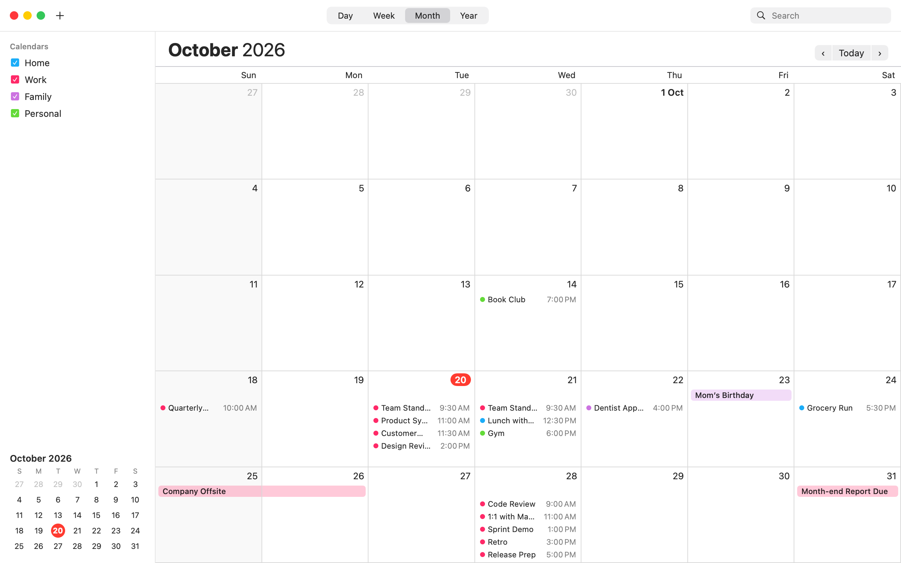
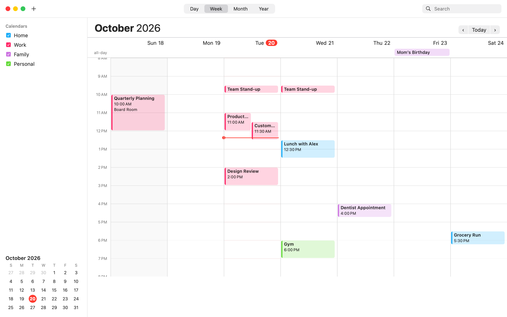
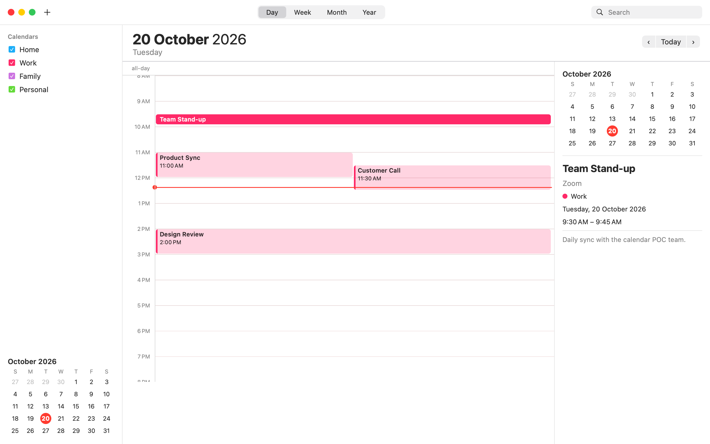
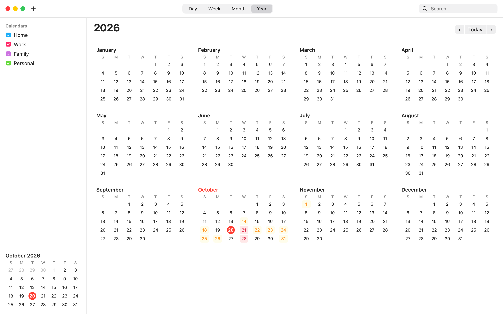
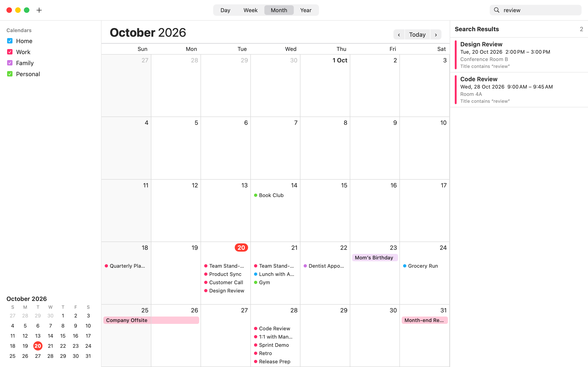
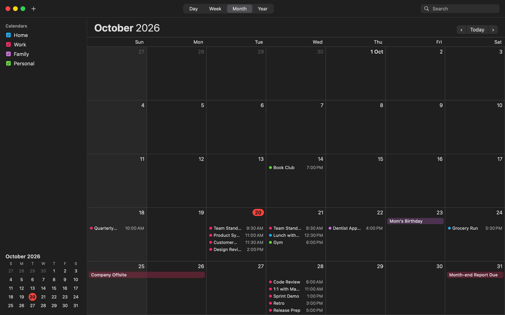

# Calendar Reconstruction (POC)

A separate, runnable macOS app that reconstructs the core behavior of Apple's Calendar.app:
month, week, day and year views, date navigation, event create/edit/delete, all-day events,
multiple coloured calendars, search, and local persistence. The behavior and visual details come
from reverse-engineering evidence collected with **REA** (Reverse Engineer Anything). See
[docs/REVERSE_ENGINEERING_REPORT.md](docs/REVERSE_ENGINEERING_REPORT.md).

It is independent code (Swift + SwiftUI). It contains no Apple source code or assets, and it never
reads or writes your real calendars.



## Download and run (no build needed)

1. Download **[CalendarReconstruction-macOS.zip](https://github.com/E2-Veera/calendar-reconstruction/releases/latest/download/CalendarReconstruction-macOS.zip)**
   from the [latest release](https://github.com/E2-Veera/calendar-reconstruction/releases/latest).
   It's a universal app for Apple Silicon and Intel, macOS 14 or later.
2. Unzip it and move **Calendar Reconstruction.app** to Applications (optional).
3. The app is ad-hoc signed, not notarized by Apple, so the first launch is blocked by Gatekeeper. Either:
   - right-click the app ▸ **Open** ▸ **Open**, or, on macOS 15 and later, open it once and then go to
     System Settings ▸ Privacy & Security ▸ **Open Anyway**; or
   - in Terminal: `xattr -dr com.apple.quarantine "/path/to/Calendar Reconstruction.app"`

The app opens with demo calendars and events around today. It stores data only in
`~/Library/Application Support/CalendarReconstruction/`, and it does not ask for access to your
real calendars.

| Week | Day | Year |
|---|---|---|
|  |  |  |

| Search | Dark mode |
|---|---|
|  |  |

## Prerequisites (to build from source)

| Need | Version used to build/test | Notes |
|---|---|---|
| macOS | 26.5 (arm64) | App targets macOS 14+ |
| Xcode or Command Line Tools with Swift | Xcode 26.0, Swift 6.2 | `swift --version` |
| Node.js + npm | Node 26.12 | Only for re-collecting REA evidence |

## Build and launch

```bash
cd ~/CalendarReconstruction
./scripts/build_app.sh                       # → build/Calendar Reconstruction.app
open "build/Calendar Reconstruction.app"     # launch
```

To run without bundling: `swift run CalendarReconstruction`.

The first launch seeds demo calendars (Home, Work, Family, Personal) and about 20 events placed
around **today**, so every view has content right away.

### Command-line options

```bash
APP="build/Calendar Reconstruction.app/Contents/MacOS/CalendarReconstruction"
"$APP" --reset                       # wipe the data file and re-seed demo events, then open the window
"$APP" --store /tmp/demo.json        # use a different data file
"$APP" --list-events                 # print all events as JSON (no window)
"$APP" --add-event "Standup" --start 2026-10-21T09:30 --end 2026-10-21T09:45 --calendar Work
"$APP" --add-event "Holiday" --start 2026-10-24 --all-day
"$APP" --search review               # headless search
"$APP" --render-screenshots out/     # render every view to PNG offscreen
"$APP" --help
```

The data file lives at `~/Library/Application Support/CalendarReconstruction/calendar-store.json`.
The app saves after every change.

## Using the app

| Action | How | Calendar.app equivalent (recovered) |
|---|---|---|
| Switch view | Toolbar Day/Week/Month/Year, or ⌘1 / ⌘2 / ⌘3 / ⌘4 | `switchToDayView:` … ⌘1–⌘4 |
| Previous / next period | ‹ › buttons, or ⌘← / ⌘→ | "Previous" / "Next" ⌘← ⌘→ |
| Today | Today button, or ⌘T | "Go to Today" ⌘T (`goToCurrentDay:`) |
| Go to a date | ⇧⌘T | "Go to Date…" ⇧⌘T (`goToDay:`) |
| New event | + button, ⌘N, or double-click an empty day/time slot | "New Event" ⌘N (`newEventCommand:`) |
| New all-day event | Double-click the all-day strip in week/day view | — |
| Select / edit event | Click / double-click it, or ⌘E | "Edit Event" ⌘E (`editEvent:`) |
| Delete event | Delete key, Edit ▸ Delete Event, right-click ▸ Delete, or Delete in the form | `delete:` |
| Search | Search field in the toolbar (⌘F), then click a result to jump to it | "Find" ⌘F |
| Show/hide a calendar | Click its checkbox in the sidebar | calendar list checkboxes |
| New calendar | Sidebar + button, or ⌥⌘N | "New Calendar" ⌥⌘N |
| Rename/recolour/delete calendar | Right-click the calendar in the sidebar | "Get Info" / Delete |

## Tests

```bash
./scripts/run_tests.sh
```

This runs 40 XCTest unit tests and 7 end-to-end checks: build, GUI launch with a window on screen,
seeded first launch, persistence across separate processes (including after a GUI session), delete
persistence, headless search, and offscreen renders. Results go to `docs/test-results/`, with the
summary in [docs/test-results/summary.md](docs/test-results/summary.md). The tests use a throwaway
data file.

## Project layout

```
Package.swift
Sources/CalendarCore/            models, JSON store, date math, layout engine, controller (no UI)
Sources/CalendarReconstruction/  SwiftUI app, menu commands, headless CLI, offscreen renderer
Tests/CalendarCoreTests/         unit tests
scripts/collect_evidence.sh      re-runs the REA static analysis of Calendar.app
scripts/capture_live_ui.sh       REA AX tree + screenshots of original vs reconstruction (needs permissions)
scripts/build_app.sh             builds the .app bundle
scripts/run_tests.sh             all automated tests
evidence/rea/                    raw REA output + readable summaries (menu, colours, data model, strings)
evidence/screenshots/            renders of the reconstruction
docs/                            reverse-engineering report, demo script, test results
tools/                           local REA install (npm rea-agents@6.5.0)
```

## Re-collecting evidence

Raw files extracted from Apple's Calendar.app aren't committed to this repository, because the
string tables, scripting dictionary, decoded nibs and asset-catalog dump are Apple's resources.
The `evidence/rea/*.md` summaries and REA's metadata output are included. Regenerate the rest on
any Mac:

```bash
(cd tools && npm install)        # installs rea-agents 6.5.0 if tools/node_modules is missing
./scripts/collect_evidence.sh    # static REA analysis → evidence/rea/
./scripts/capture_live_ui.sh     # live AX tree + window screenshots (needs permissions, see below)
```

## Troubleshooting

| Symptom | Fix |
|---|---|
| `Operation not permitted` / `uv_cwd` errors | The shell is in a privacy-protected folder (this happened with `~/Documents`). `cd ~/CalendarReconstruction` first, or give Terminal access under System Settings → Privacy & Security → Files and Folders. |
| REA says `accessibility-denied` or `screen-recording-denied` | Enable Terminal under Privacy & Security → Accessibility and → Screen & System Audio Recording, then **quit and reopen Terminal**. |
| App opens behind other windows, or not at all, via `swift run` | Use the bundled app: `./scripts/build_app.sh && open "build/Calendar Reconstruction.app"`. |
| "App can't be opened" on another Mac | It's ad-hoc signed. Right-click ▸ Open, or run `xattr -dr com.apple.quarantine "Calendar Reconstruction.app"`. |
| Want a clean demo | Launch with `--reset`. |
| Red banner "Couldn't save calendar data" | Check that `~/Library/Application Support/CalendarReconstruction/` is writable. |
| Data file corrupted | On the next launch the app moves it aside to `calendar-store.corrupt-<time>.json` and re-seeds the demo data. |
| `swift test` can't find XCTest | Install full Xcode and run `sudo xcode-select -s /Applications/Xcode.app`. |
